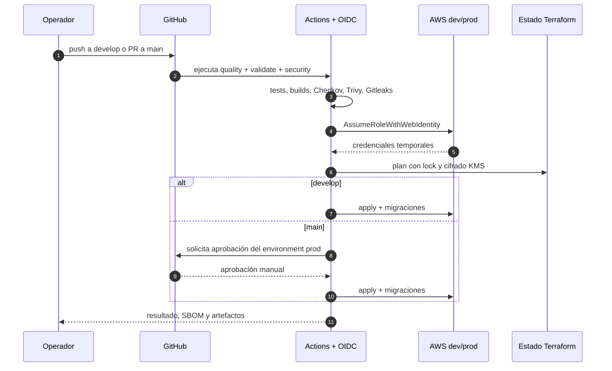

<br>

<div align="center">
  <a href="https://emanuelgm98.github.io/Vanguard-presentation/"><strong>Ver presentación en vivo</strong></a>
</div>

<br>

<div align="center">
  
  <br>
  <sub><strong>GRIFFIN CLI</strong> · Sello de <strong>Emanuel G. Michea</strong></sub>
</div>

<h1 align="center">VANGUARD PRIVATE OPERATIONS</h1>

<p align="center">
  Plataforma privada de operaciones y liquidación de comisiones para Vanguard.<br>
  Infraestructura como código, entrega GitOps y seguridad por defecto.
</p>

<p align="center">
  <a href="https://github.com/Emanuelgm98/aura-private-operations/actions/workflows/ci-cd-dev.yml"></a>
  <a href="https://github.com/Emanuelgm98/aura-private-operations/actions/workflows/ci-cd-prod.yml"></a>
  
</p>

<p align="center">
  
  
  
</p>

<p align="center">
  
</p>

> **Estado:** scaffold GitOps completo, validado localmente y listo para bootstrap.
> **No se ha creado ningún recurso en AWS.** Cualquier `apply` requiere autorización
> explícita y ocurre exclusivamente desde GitHub Actions con OIDC.

---

## En una frase

VANGUARD PRIVATE OPERATIONS convierte la operación de comisiones en un sistema auditable:
frontend estático privado, API serverless en VPC, PostgreSQL con precisión decimal,
ledger append-only, identidad con MFA y un pipeline que no permite cambios fuera de Git.

## Presentación

La presentación del producto está en [Vanguard presentation](https://emanuelgm98.github.io/Vanguard-presentation/):
explica el problema, las capacidades y el modelo de seguridad sin exponer la consola operativa.
El código fuente vive en [`apps/frontend/app/presentacion`](https://github.com/Emanuelgm98/aura-private-operations/tree/main/apps/frontend/app/presentacion).

Para verla en local:

```bash
cd apps/frontend && npm run dev
# http://localhost:3000/presentacion/
```

## Principios no negociables

| Principio | Implementación |
| --- | --- |
| GitOps puro / cero consola | Todo recurso nace en Terraform. GitHub Actions es el único ejecutor. |
| Sin credenciales estáticas | GitHub Actions asume roles vía OIDC + `sts:AssumeRoleWithWebIdentity`. |
| Frontend sin Amplify | Next.js `output: export` en S3 privado + CloudFront OAC + AWS WAF. |
| Identidad fuerte | Cognito con MFA obligatorio (`ON`), JWT y authorizer JWT en API Gateway. |
| Backend defendido | Lambda en VPC, concurrencia reservada, validación Zod e idempotencia DynamoDB. |
| Dinero exacto | PostgreSQL `NUMERIC(18,6)`; cero `FLOAT`; ledger append-only con trigger. |
| Migraciones seguras | Runner forward-only con checksum, advisory lock y ejecución desde Lambda en VPC. |
| Supply chain | Checkov, Trivy, Gitleaks, Dependabot, SBOM SPDX y actions con permisos mínimos. |

## Capacidades

| Capacidad | Detalle |
| --- | --- |
| Operaciones | Registro y consulta de comisiones con validación de entrada y trazabilidad. |
| Liquidación | Cálculo exacto en base de datos, sin aritmética flotante. |
| Auditoría | Ledger append-only protegido por trigger; historial inmutable. |
| Idempotencia | Claves DynamoDB con TTL para evitar dobles registros. |
| Acceso | OAuth2 Authorization Code + PKCE; MFA obligatorio en Cognito. |
| Entrega | `develop` despliega dev; `main` requiere aprobación manual para prod. |
| Observabilidad | Alarmas, dashboard, logs estructurados y retención de 365 días. |
| Continuidad | Backups automáticos, PITR y runbook de recuperación documentado. |

## Arquitectura

<p align="center">
  
</p>

Detalle completo en [`docs/ARCHITECTURE.md`](https://github.com/Emanuelgm98/aura-private-operations/blob/main/docs/ARCHITECTURE.md).

## Flujo GitOps



| Rama | Workflow | Entorno | Comportamiento |
| --- | --- | --- | --- |
| `develop` | `ci-cd-dev.yml` | `dev` | Plan + apply automático. |
| `main` | `ci-cd-prod.yml` | `prod` | Plan + apply con aprobación manual. |
| Pull request | Ambos | — | Solo validación y plan; nunca apply. |

## Modelo de seguridad

| Capa | Controles |
| --- | --- |
| Borde | CloudFront, OAC, WAF con rate limiting, TLS y cabeceras de seguridad. |
| Identidad | Cognito, MFA obligatorio, PKCE, JWT authorizer y roles OIDC de mínima confianza. |
| Red | VPC privada, subredes aisladas, security groups sin egreso/ingreso implícito. |
| Datos | KMS, cifrado en reposo y tránsito, RDS privado, backups y PITR. |
| Aplicación | Validación Zod, idempotencia, concurrencia reservada y errores sin fuga de datos. |
| Cadena de suministro | Dependabot, auditoría de dependencias, SBOM y actions fijadas. |
| Operación | CloudWatch, alarmas, retención de logs, runbook y DR documentados. |

## Stack

| Área | Tecnología |
| --- | --- |
| Frontend | Next.js 15, React 19, TypeScript, export estático |
| Backend | Node.js 22, TypeScript, Lambda, Zod |
| Datos | RDS PostgreSQL, DynamoDB, Secrets Manager |
| Identidad | Amazon Cognito + OAuth2 PKCE |
| Infraestructura | Terraform 1.17, AWS provider 6.x, módulos reutilizables |
| Entrega | GitHub Actions, OIDC, ambientes protegidos |
| Seguridad | Checkov, Trivy, Gitleaks, SBOM SPDX, Dependabot |
| Automatización | n8n sin secretos embebidos |

## Estructura

```text
apps/
  frontend/                 Next.js 15 static export + OAuth2 PKCE
  backend/                  Lambda Node.js 22 (router, ledger, migrador)
assets/branding/            Banner Vanguard, emblema grifón y sello verificado
infrastructure/terraform/
  bootstrap/                S3+KMS estado, DynamoDB lock, OIDC GitHub, roles/boundary
  modules/                  network, database, identity, api, frontend, observability
  environments/dev|prod/    composición por cuenta/entorno
automation/n8n/workflows/   automatizaciones sin secretos embebidos
database/migrations/        SQL forward-only (base + variantes dev)
security/policies/          políticas IAM canónicas y boundary
security/sbom/              SBOM generados por CI (artefactos)
tests/                      smoke, integración y carga
docs/                       arquitectura, runbook, DR, privacidad, seguridad, costos
.github/workflows/          ci-cd-dev.yml, ci-cd-prod.yml
```

## Inicio rápido (operador autorizado)

### 0. Prerrequisitos

- Terraform >= 1.9, AWS CLI v2, Node.js 22+, `gh` autenticado.
- Permisos de administrador **solo** para ejecutar el bootstrap una vez por cuenta.
- Una cuenta AWS por entorno (recomendado) o cuentas separadas dev/prod.

### 1. Bootstrap del estado remoto y OIDC

Única acción con credenciales humanas:

```bash
cd infrastructure/terraform/bootstrap
terraform init
terraform plan  -var="environment=dev" -var="github_org=<org>" -var="github_repo=<repo>"
terraform apply -var="environment=dev" -var="github_org=<org>" -var="github_repo=<repo>"
```

El bootstrap crea:

- Bucket S3 de estado versionado y cifrado con KMS CMK (+ bloqueo público y TLS-only).
- Tabla DynamoDB de locking con PITR y deletion protection.
- Provider OIDC de GitHub y roles `gha-plan` / `gha-apply` por entorno.
- Permissions boundary que impide crear usuarios, access keys o tocar el boundary.

Repetir en la cuenta de producción con `-var="environment=prod"`.

### 2. Configurar GitHub

Settings → Variables:

| Variable | Origen |
| --- | --- |
| `AWS_PLAN_ROLE_ARN` / `AWS_APPLY_ROLE_ARN` | outputs `plan_role_arn` / `apply_role_arn` |
| `TF_STATE_BUCKET`, `TF_LOCK_TABLE` | outputs `state_bucket_name` / `lock_table_name` |
| `TF_STATE_KMS_KEY_ARN` | output `state_kms_key_arn` |
| `TF_PERMISSIONS_BOUNDARY_ARN` | output `permissions_boundary_arn` |
| `ALERT_EMAIL` | email de on-call (opcional) |
| `CUSTOM_DOMAIN`, `ACM_CERTIFICATE_ARN` | dominio propio (opcional, ACM en us-east-1) |

No se configuran credenciales AWS como secrets: el workflow usa `id-token: write`.
Los environments de GitHub deben llamarse exactamente `dev` y `prod` para coincidir
con los subjects OIDC emitidos por el bootstrap.

### 3. Migraciones

El pipeline invoca la Lambda migradora después del `apply`. No hay acceso directo a RDS
desde runners de GitHub. Las migraciones son inmutables y solo hacia adelante.

## Validación local

| Superficie | Comando | Resultado |
| --- | --- | --- |
| Backend | `npm test` | 47/47 tests |
| Backend build | `npm run build` | `dist/vanguard-backend.zip` |
| Frontend | `npm run lint && npm run typecheck && npm run build` | OK |
| Terraform | `terraform fmt -check -recursive` | OK |
| Terraform dev | `terraform validate` | OK |
| Terraform prod | `terraform validate` | OK |
| Terraform bootstrap | `terraform validate` | OK |
| Checkov | `checkov -d infrastructure/terraform` | 338/338 |

```bash
# Backend
cd apps/backend && npm ci && npm test && npm run build

# Frontend
cd apps/frontend && npm ci && npm run lint && npm run typecheck && npm run build

# Terraform (sin backend, solo validación)
terraform -chdir=infrastructure/terraform/environments/dev init -backend=false
terraform -chdir=infrastructure/terraform/environments/dev validate
```

## Autoría y auditoría

| Rol | Responsable |
| --- | --- |
| Autor, operador y auditor | **Emanuel Gonzalez Michea** |
| Sello | **GRIFFIN CLI** |
| Repositorio | `Emanuelgm98/aura-private-operations` |
| Trazabilidad | Git, PR, CloudTrail, CloudWatch y ledger append-only |
| Revisión de seguridad | Checkov, Trivy, Gitleaks, SBOM y Dependabot en cada pipeline |

Cada cambio queda registrado en Git y debe superar validación, pruebas y escaneos de
seguridad antes de llegar a `main`. La auditoría técnica, la revisión de infraestructura y
la aprobación de producción son responsabilidad de **Emanuel Gonzalez Michea**.

## Documentación

| Documento | Contenido |
| --- | --- |
| [Arquitectura](https://github.com/Emanuelgm98/aura-private-operations/blob/main/docs/ARCHITECTURE.md) | Componentes, redes, identidad y decisiones. |
| [Runbook](https://github.com/Emanuelgm98/aura-private-operations/blob/main/docs/RUNBOOK.md) | Operación, despliegues, incidentes y rollback. |
| [Disaster Recovery](https://github.com/Emanuelgm98/aura-private-operations/blob/main/docs/DISASTER-RECOVERY.md) | RPO/RTO, backups y recuperación. |
| [Privacidad](https://github.com/Emanuelgm98/aura-private-operations/blob/main/docs/PRIVACY.md) | Datos tratados, retención y minimización. |
| [Seguridad](https://github.com/Emanuelgm98/aura-private-operations/blob/main/docs/SECURITY.md) | Controles, modelo de amenazas y respuesta. |
| [Costos](https://github.com/Emanuelgm98/aura-private-operations/blob/main/docs/COSTS.md) | Estimación por entorno y palancas de ahorro. |

---

<div align="center">
  
  <br>
  <sub><strong>GRIFFIN CLI</strong> · <em>Diseñado para operar, no para improvisar.</em></sub><br>
  <sub>Emanuel Gonzalez Michea · Autor y auditor</sub>
</div>

<br>

<div align="center">
  <sub>Propiedad de Vanguard. Uso interno. Sin licencia de redistribución.</sub><br>
  <sub>© VANGUARD PRIVATE OPERATIONS · GRIFFIN CLI · Emanuel G. Michea</sub>
</div>
